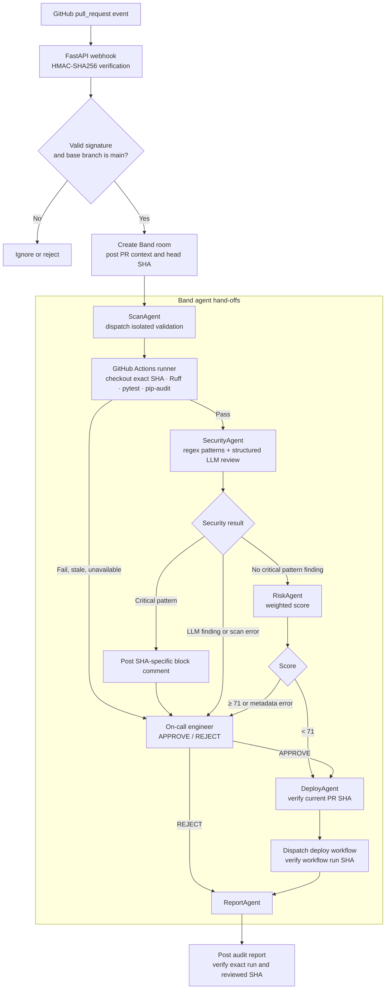
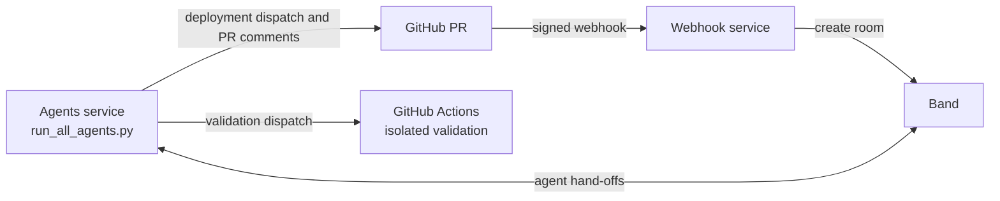

# MergeGuard architecture

MergeGuard reviews pull requests through five Band-coordinated agents. Review actions are
bound to the PR head SHA captured by the webhook. Tests, lint, and dependency auditing run
in a separate GitHub Actions job so untrusted PR code never executes in the long-lived
agent service.

## Review flow

## Agents and responsibilities

| Agent | Responsibility | Decision |
|---|---|---|
| **ScanAgent** | Dispatches validation for the exact PR head commit. | Any failed, stale, missing, or timed-out result blocks the automatic path. |
| **SecurityAgent** | Runs deterministic diff patterns and a structured LLM advisory scan. | Critical pattern findings block; LLM findings or scan errors escalate. |
| **RiskAgent** | Scores changed files, diff size, timing, and upstream warnings. | Scores below 71 pass; higher scores or unavailable metadata escalate. |
| **DeployAgent** | Dispatches the configured deployment workflow from trusted `main`. | Passes the reviewed SHA as an input and checks the run's unique SHA marker. |
| **ReportAgent** | Posts the final review and deployment status. | Reports rejected, blocked, failed, in-progress, or unknown states explicitly. |

## Isolated PR validation

`tools/pr_validation.py` dispatches `.github/workflows/pr-validation.yml` in
`PR_VALIDATION_REPO`. The workflow:

1. Verifies the requested repository against the `TARGET_REPO` Actions secret.
2. Checks out the requested commit SHA using `GH_PAT`, with `persist-credentials: false`.
3. Runs Ruff, the PR's pytest suite, and dependency auditing on a GitHub-hosted runner.
4. Runs with `permissions: {}`. The checked-out code does not receive the checkout token or
   an Actions write token.

Configure `TARGET_REPO` and `GH_PAT` as Actions secrets in the validation-workflow repository.
`GH_PAT` needs read-only contents access to the target repository. The service's
`GITHUB_TOKEN` needs permission to dispatch and inspect workflow runs in `PR_VALIDATION_REPO`.

The target deployment workflow must define `head_sha`, `pr_number`, and `request_id`
workflow-dispatch inputs, use `head_sha` for checkout, and include both `request_id` and
`head_sha` in its run name. MergeGuard dispatches the workflow from trusted `main`, never the
untrusted PR branch; workflows without this contract are rejected or reported as unknown.

## Risk scoring

The score is capped at 100. A score of 71 or more requires human approval.

| Signal | Weight |
|---|---:|
| Auth-related files changed | +30 |
| Payment-related files changed | +40 |
| Friday deploy | +15 |
| Diff larger than 500 lines | +10 |
| Each upstream warning | +5, capped at +20 |

If GitHub metadata cannot be fetched or the PR head no longer matches the reviewed SHA,
RiskAgent escalates rather than calculating a zero-risk score.

## Runtime and deployment

The FastAPI webhook and all five agent loops run as two services:

Docker Compose and the Railway layout use the same two-service model: `webhook`
(`python -m webhook.main`) and `agents` (`python -m run_all_agents`).
