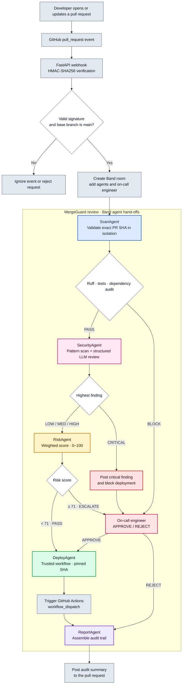

# MergeGuard

**Build status**<br>
[](https://github.com/PiyushAgarwalcs/MergeGuard-Automated-PR-Security-Policy-Enforcement/actions/workflows/ci.yml)
[](https://github.com/PiyushAgarwalcs/MergeGuard-Automated-PR-Security-Policy-Enforcement/actions/workflows/pr-validation.yml)
[](https://github.com/PiyushAgarwalcs/MergeGuard-Automated-PR-Security-Policy-Enforcement/actions/workflows/deploy.yml)
[](LICENSE)

**Agents and models**<br>
[](https://www.python.org/downloads/release/python-3110/)
[](https://band.ai/)
[](https://langchain-ai.github.io/langgraph/)
[](https://python.langchain.com/)
[](https://python.langchain.com/docs/integrations/chat/openai/)
[](https://featherless.ai/)
[](https://aimlapi.com/)

**API and configuration**<br>
[](https://fastapi.tiangolo.com/)
[](https://www.uvicorn.org/)
[](https://www.python-httpx.org/)
[](https://pygithub.readthedocs.io/)
[](https://docs.pydantic.dev/)
[](https://pyyaml.org/)
[](https://github.com/theskumar/python-dotenv)

**Infrastructure**<br>
[](https://docs.github.com/actions)
[](https://www.docker.com/)
[](https://docs.docker.com/compose/)
[](https://railway.com/)

**Quality checks**<br>
[](https://docs.pytest.org/)
[](https://pytest-asyncio.readthedocs.io/)
[](https://github.com/pypa/pip-audit)
[](https://docs.astral.sh/ruff/)
[](https://black.readthedocs.io/)
[](https://mypy.readthedocs.io/)

**A multi-agent pull request review and deployment gate.**

MergeGuard coordinates five specialist agents to analyze pull requests, apply risk-based deployment policy, and publish an audit report. Deterministic tools enforce the review gates; pull-request tests, lint, and dependency audits run on an isolated GitHub Actions runner against the exact reviewed commit.

[Workflow](#review-workflow) · [Technology](#technology) · [Getting started](#getting-started) · [Deployment](#deployment)

## Review workflow



Each agent has its own color in the diagram: **Scan** blue, **Security** pink, **Risk** amber, **Deploy** green, and **Report** purple. The on-call engineer is shown in red.

### Agent responsibilities

| Agent | Responsibility | Key outcome |
|---|---|---|
| **ScanAgent** | Dispatches Ruff, the PR test suite, and dependency auditing on an isolated runner. | Failed, stale, or unavailable validation blocks the automatic path. |
| **SecurityAgent** | Scans the exact PR diff with deterministic patterns and a structured LLM review. | Critical pattern findings block; LLM findings or scan errors require human review. |
| **RiskAgent** | Scores risk from change characteristics and upstream warnings. | Scores below 71 pass; scores of 71 or higher require human review. |
| **DeployAgent** | Dispatches the trusted deployment workflow from `main` with the reviewed SHA. | Runs only after approval and verifies the correlated workflow run. |
| **ReportAgent** | Collects review and deployment outcomes. | Reports the decision and only claims success for the verified run. |

For detailed decision branches, risk weights, and deployment topology, see [ARCHITECTURE.md](ARCHITECTURE.md).

## Design principles

- **Deterministic enforcement:** security scanning, risk scoring, deployment triggering, and report assembly are implemented as tools rather than relying solely on model-generated decisions.
- **Fail closed:** critical findings, stale commits, and unavailable validation or metadata cannot pass automatically.
- **Untrusted code stays isolated:** PR tests and dependency installation run on an ephemeral GitHub-hosted runner with no workflow write permissions and no checkout credentials persisted to the workspace.
- **Human approval for elevated risk:** high risk scores and blocked reviews route to the on-call engineer for an in-chat decision.
- **Traceable outcomes:** the final report summarizes review and deployment results.

## Technology

| Area | Technologies |
|---|---|
| Language and agent orchestration | Python 3.11, Band SDK, LangGraph, LangChain Core, LangChain OpenAI |
| Model providers | Featherless AI and AIMLAPI |
| Webhook and HTTP | FastAPI, Uvicorn, HTTPX |
| GitHub integration | PyGithub, GitHub Actions |
| Validation and configuration | Pydantic, PyYAML, python-dotenv |
| Packaging and hosting | Docker, Docker Compose, Railway |
| Development and security checks | pytest, pytest-asyncio, pip-audit, Ruff, Black, mypy |

## Getting started

### Requirements

- Python 3.11
- GitHub credentials with the permissions needed to read pull requests, write comments, and dispatch the configured workflow
- Band agent credentials and a supported model-provider API key

### Install

Create and activate a virtual environment, then install runtime dependencies:

```powershell
python -m venv .venv
.\.venv\Scripts\Activate.ps1
pip install -r requirements.txt
Copy-Item .env.example .env
```

On macOS or Linux:

```bash
python -m venv .venv
source .venv/bin/activate
pip install -r requirements.txt
cp .env.example .env
```

Set the required values in `.env`. At minimum, configure the Band service and agent credentials, model-provider credentials, `GITHUB_TOKEN`, `TARGET_REPO`, and `GITHUB_WEBHOOK_SECRET`. `PR_VALIDATION_REPO` identifies the repository that hosts this project's `pr-validation.yml` workflow; the GitHub token must be able to dispatch it. Set `DEPLOY_WORKFLOW_FILE` to the workflow file in the target repository.

Do not commit `.env` or real credentials.

In the validation-workflow repository, configure `TARGET_REPO` and `GH_PAT` as Actions secrets. `GH_PAT` needs read-only contents access to the target repository for checkout. The service's `GITHUB_TOKEN` needs permission to dispatch and inspect workflow runs in `PR_VALIDATION_REPO`. The validation job disables `GITHUB_TOKEN` permissions and does not persist checkout credentials.

The target's deployment workflow must accept `head_sha`, `pr_number`, and `request_id` as `workflow_dispatch` inputs, check out and deploy the artifact built from `head_sha`, and include the request ID and SHA in its run name. MergeGuard dispatches only the workflow version from trusted `main`; a target workflow that does not honor this contract is not treated as a verified deployment.

### Run locally

Start the webhook and agent runtime in separate terminals:

```bash
python -m webhook.main
```

```bash
python -m run_all_agents
```

The webhook listens on port `8000` by default. Configure a GitHub pull-request webhook to reach `/webhook`, using the same secret as `GITHUB_WEBHOOK_SECRET`.

### Run checks

```bash
pip install -r requirements-dev.txt
python -m pytest tests/ -q
ruff check .
black --check .
mypy shared/ tools/ webhook/ agents/ --ignore-missing-imports
```

These are MergeGuard's own unit and quality checks. For local checks, install `requirements-dev.txt`; PR code is tested by the dispatched isolated workflow, not by running it inside the long-lived agent service.

## Deployment

The repository includes a Dockerfile, a two-service Docker Compose configuration, and GitHub Actions workflows for CI, isolated PR validation, and deployment. Docker Compose and the documented Railway layout both use a public `webhook` service (`python -m webhook.main`) and a single `agents` service (`python -m run_all_agents`). Configure the required environment variables and Actions secrets before enabling live webhooks or deployment triggers.

## Repository layout

```text
agents/              Five specialist agents
tools/               Scanning, risk, GitHub, deployment, and reporting tools
shared/              Agent runtime wiring, schemas, and shared helpers
webhook/             Webhook verification, parsing, and Band room initiation
tests/               Unit tests and pull-request fixtures
run_all_agents.py    Runs all five agents in one process
ARCHITECTURE.md      Pipeline details, risk weights, and deployment topology
```
