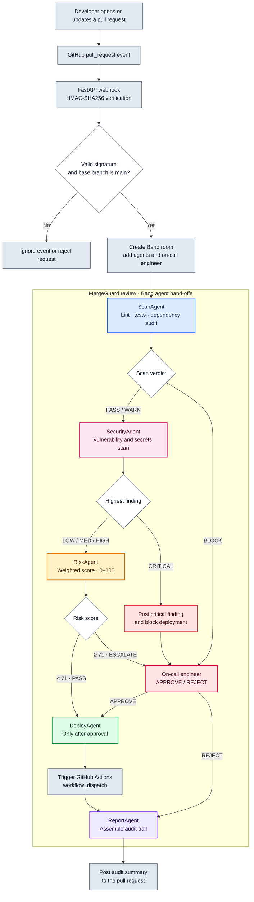

# MergeGuard

[](https://github.com/PiyushAgarwalcs/MergeGuard-Automated-PR-Security-Policy-Enforcement/actions/workflows/ci.yml)
[](https://www.python.org/downloads/release/python-3110/)
[](LICENSE)

**A multi-agent pull request review and deployment gate.**

MergeGuard coordinates five specialist agents to analyze pull requests, apply risk-based deployment policy, and publish an audit report. Deterministic tools perform checks and enforce critical security outcomes; agents coordinate the review and hand off decisions through Band.

## Review workflow



Each agent has its own color in the diagram: **Scan** blue, **Security** pink, **Risk** amber, **Deploy** green, and **Report** purple. The on-call engineer is shown in red.

### Agent responsibilities

| Agent | Responsibility | Key outcome |
|---|---|---|
| **ScanAgent** | Runs static analysis, tests, and dependency auditing. | Passes findings onward or blocks the review. |
| **SecurityAgent** | Scans the pull request diff for vulnerabilities and secrets. | Critical findings create a PR comment and block deployment. |
| **RiskAgent** | Scores risk from change characteristics and upstream warnings. | Scores below 71 pass; scores of 71 or higher require human review. |
| **DeployAgent** | Triggers the configured GitHub Actions deployment workflow. | Runs only after the review is approved. |
| **ReportAgent** | Collects review and deployment outcomes. | Publishes the final audit summary. |

For detailed decision branches, risk weights, and deployment topology, see [ARCHITECTURE.md](ARCHITECTURE.md).

## Design principles

- **Deterministic enforcement:** security scanning, risk scoring, deployment triggering, and report assembly are implemented as tools rather than relying solely on model-generated decisions.
- **Fail closed on critical findings:** a critical security finding blocks deployment and is surfaced on the pull request.
- **Human approval for elevated risk:** high risk scores and blocked reviews route to the on-call engineer for an in-chat decision.
- **Traceable outcomes:** the final report summarizes review and deployment results.

## Technology

| Component | Technology |
|---|---|
| Agent coordination | Band (`band-sdk[langgraph]`) |
| Agent runtime | LangGraph ReAct agents |
| Model providers | Featherless or AIMLAPI (OpenAI-compatible APIs) |
| Webhook service | FastAPI with HMAC-SHA256 verification |
| Review and deployment integration | GitHub API and GitHub Actions |
| Packaging and deployment | Docker; Railway configuration is included |
| Quality checks | pytest, Ruff, Black, mypy, GitHub Actions |

## Getting started

### Requirements

- Python 3.11
- GitHub credentials with the permissions needed to read pull requests, write comments, and dispatch the configured workflow
- Band agent credentials and a supported model-provider API key

### Install

Create and activate a virtual environment, then install dependencies:

```powershell
python -m venv .venv
.\.venv\Scripts\Activate.ps1
pip install -r requirements.txt
Copy-Item .env.example .env
```

On macOS or Linux:

```bash
python -m venv .venv
source .venv/bin/activate
pip install -r requirements.txt
cp .env.example .env
```

Set the required values in `.env`. At minimum, configure the Band service and agent credentials, model-provider credentials, `GITHUB_TOKEN`, `TARGET_REPO`, and `GITHUB_WEBHOOK_SECRET`. Set `DEPLOY_WORKFLOW_FILE` to the workflow file in the target repository.

Do not commit `.env` or real credentials.

### Run locally

Start the webhook and agent runtime in separate terminals:

```bash
python -m webhook.main
```

```bash
python -m run_all_agents
```

The webhook listens on port `8000` by default. Configure a GitHub pull-request webhook to reach `/webhook`, using the same secret as `GITHUB_WEBHOOK_SECRET`.

### Run checks

```bash
ruff check .
black --check .
mypy shared/ tools/ webhook/ agents/ --ignore-missing-imports
pytest tests/ -q
```

## Deployment

The repository includes a Dockerfile, a Docker Compose configuration, and a GitHub Actions workflow for CI and deployment. The documented Railway layout uses a public `webhook` service (`python -m webhook.main`) and an `agents` service (`python -m run_all_agents`). Configure the required environment variables and deployment secrets in the hosting and GitHub environments before enabling live webhooks or deployment triggers.

## Repository layout

```text
agents/              Five specialist agents
tools/               Scanning, risk, GitHub, deployment, and reporting tools
shared/              Agent runtime wiring, schemas, and shared helpers
webhook/             Webhook verification, parsing, and Band room initiation
tests/               Unit tests and pull-request fixtures
run_all_agents.py    Runs all five agents in one process
ARCHITECTURE.md      Pipeline details, risk weights, and deployment topology
```
